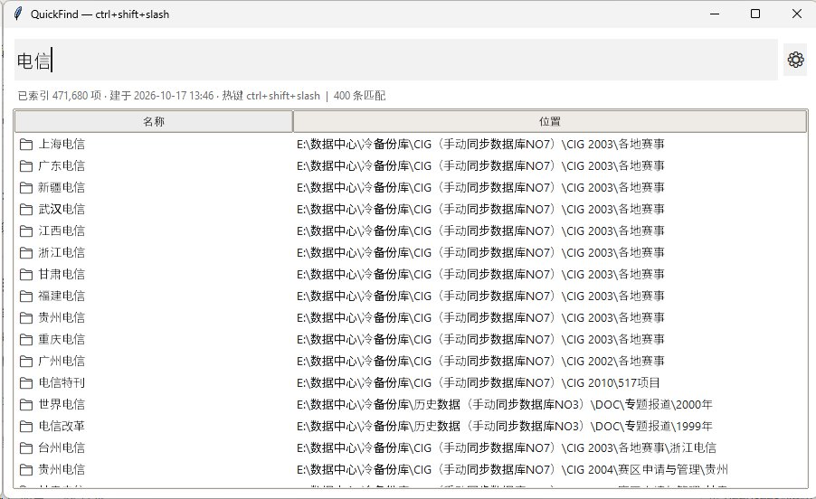
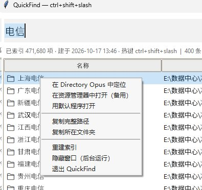
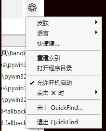
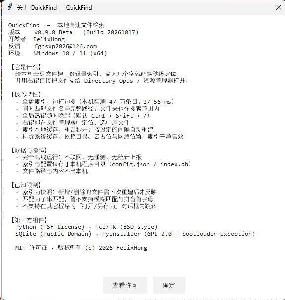

# QuickFind

**轻量、纯离线的 Windows 全盘秒搜工具 —— 一键在 Directory Opus 或资源管理器中定位文件。**

敲几个字，回车打开。右键结果直接在文件管理器里跳到原位置，并且**已经选中**那个文件。

> Listary / Everything 的一个小替代品，约 1200 行**零第三方依赖**的 Python 写成。
> [English](README.md)

---

## 界面截图



<p>
  
  
  
</p>

<sub>皮肤、语言、快捷键、开机启动、✕ 行为都在右上角 ⚙ 菜单里。</sub>

---

## 为什么要再造一个？

| | QuickFind | Everything | Listary |
|---|---|---|---|
| 全盘索引 + 子串秒搜 | ✅ | ✅ | ✅ |
| **在 Directory Opus 中定位并选中** | ✅ | ❌ | ⚠️ 部分支持 |
| 纯 Python，一下午就能读懂改完 | ✅ | ❌ 闭源 | ❌ 闭源 |
| 不需要管理员权限 / 内核驱动 / 服务 | ✅ | ⚠️ 需要服务 | ✅ |
| 重建索引带实时进度和时间戳 | ✅ | ✅ | ✅ |
| 多语言界面（中/英，自动识别） | ✅ | ⚠️ | ✅ |

**坦白说它跑不过 Everything** —— 它用 `os.scandir` 遍历文件系统，而不是直读 NTFS 的 MFT。
47 万文件：一次性建索引 **5 秒**，搜索 **17–56 ms**。要 Everything 级别的实时性请用 Everything；
要一个能读懂、能改、能和你的文件管理器深度配合的东西，那才是它的价值。

## 功能

- **全盘索引、边打边搜** —— 同时匹配文件名和完整路径，文件夹也能搜到
- **全局热键**（默认 `Ctrl+Shift+/`，可任意改：数字、字母、F 键、符号都支持）
- **在文件管理器中定位** —— Directory Opus（`dopusrt /cmd Go` + `Select`）或资源管理器（`/select`），自动探测
- **5 套皮肤** —— 跟随系统 / 纯黑 / 深灰 / 白底 / 灰度
- **系统托盘图标** —— 点 ✕ 是**隐藏到托盘**，进程常驻，所以**全局热键永远有效**。左键点托盘图标唤回，右键可显示/关于/退出。✕ 行为可配置（隐藏到托盘 / 最小化到任务栏 / 直接退出）
- **开机启动** —— 一个勾选框搞定
- **索引干净** —— 自动跳过系统缓存、`node_modules`、虚拟环境、云占位文件（`OFFLINE`/`RECALL_ON_*`）和网络位置（UNC/网络盘）
- **完全离线** —— 不联网、无遥测、不需要账号
- **中英双语** —— 按 Windows 界面语言自动选择，可手动切换

## 安装

### 方式一：安装包（推荐）

从 [Releases](../../releases) 下载 `QuickFind-Setup.exe` 双击安装。

装到 `%LOCALAPPDATA%\Programs\QuickFind`，自动创建开始菜单 + 开机启动快捷方式，
注册「应用和功能」卸载项，并启动程序。**不需要管理员权限。**

### 方式二：绿色版

下载 `QuickFind.exe`，放到独立目录（如 `D:\Tools\QuickFind\`）。
配置和索引会生成在 **exe 旁边**。

### 方式三：从源码运行

```bat
git clone https://github.com/<you>/quickfind.git
cd quickfind
python src\quickfind.py
```

需要 Python 3.10+（Windows 官方安装包自带 tkinter）。**无第三方依赖。**

### 首次运行

程序会在后台建索引，状态栏显示进度。默认索引你的用户主目录。
要索引更多位置：改 `config.json` 的 `roots`，然后按 `Ctrl+R` 重建。

## 使用

| 操作 | 效果 |
|---|---|
| `Ctrl+Shift+/`（全局） | 显示 / 隐藏窗口 |
| 输入 | 即时过滤 |
| `↑` / `↓` | 移动选中 |
| `Enter` / 双击 | 用默认程序打开 |
| **右键** | 在文件管理器中定位 · 复制路径 · 复制文件夹 · 重建索引 |
| `Ctrl+C` | 复制完整路径 |
| `Esc` | 隐藏 |
| `Ctrl+R` | 重建索引 |
| `⚙`（右上角） | 皮肤 · 语言 · 快捷键 · 开机启动 · 关于 |

## 配置

`config.json` 在程序（或 exe）旁边，首次运行自动生成。

```jsonc
{
  "roots": ["C:\\Users\\you"],     // 要索引的目录/磁盘，可加 "D:\\"
  "exclude_dirs": [                // 对完整路径做小写子串匹配
    "$Recycle.Bin", "System Volume Information", "\\appdata\\",
    "\\node_modules\\", "\\.git\\", "\\__pycache__\\",
    "\\site-packages\\", "\\.venv\\", "onedrive"
  ],
  "hotkey": "ctrl+shift+/",
  "reveal_app": "auto",           // auto | dopus | explorer
  "dopus_rt_path": "",            // 留空 = 自动探测 Directory Opus
  "lang": "auto",                 // auto | en | zh
  "skin": "dark",                 // auto | black | dark | light | gray
  "close_action": "tray",         // tray | minimize | quit
  "max_results": 400,
  "rebuild_hours": 12,            // 索引超期自动重建；0 = 从不
  "include_dirs": true,
  "exclude_network": true,        // 跳过 UNC 路径和网络盘
  "follow_dir_links": false
}
```

界面上改的每一项都会写回这里。

## 从源码构建

```powershell
powershell -ExecutionPolicy Bypass -File build\build.ps1
```

产出 `release\QuickFind.exe`（无控制台）和 `release\QuickFind-Setup.exe`（安装包，内嵌前一个）。

就地更新已安装版本：

```powershell
powershell -ExecutionPolicy Bypass -File build\deploy.ps1
```

## 已知限制

- 索引是**快照** —— 新增/删除的文件要等下次重建（或按 `Ctrl+R`）才反映
- 只做**子串匹配** —— 暂无模糊匹配（`qfk` → `quickfind.py`）和拼音首字母
- **不**接管其它程序的「打开/另存为」对话框（那是 Listary 的招牌功能）
- 仅 Windows（用到 `RegisterHotKey`、`GetAsyncKeyState`、`explorer /select`）

## 隐私

完全离线运行：不打开任何网络连接，不收集、不上报任何数据。
只**读取**文件名/路径/大小/修改时间等元数据，绝不修改、移动或删除用户文件。

## 常见问题

**SmartScreen / 杀毒软件报警** —— exe 未签名，且 PyInstaller 单文件打包常被启发式引擎误报。介意的话用「从源码运行」。

**热键没反应** —— 被其它程序占用了。打开 `⚙ → 快捷键…` 换一个组合；设置框读的是**物理按键状态**，数字、字母、F 键、符号都能用。

**明明存在的文件搜不到** —— 大概率不在 `roots` 里，或命中了 `exclude_dirs`。
用 `tools/check_index_completeness.py` 对比「磁盘真实文件 vs 索引」，它会告诉你被哪条规则排除了。

## 许可证

[MIT](LICENSE) © 2026 FelixHong

反馈：fghsxp2026@126.com

---

## 开发记录

开发过程、踩过的坑、错误判断与验证方法都记在 [开发日志.md](开发日志.md)（中文，约 10 KB）——
包含 10 个开发阶段、9 条 Bug 总账（现象 → 误判 → 真因）和 6 类可复现的验证手段。
